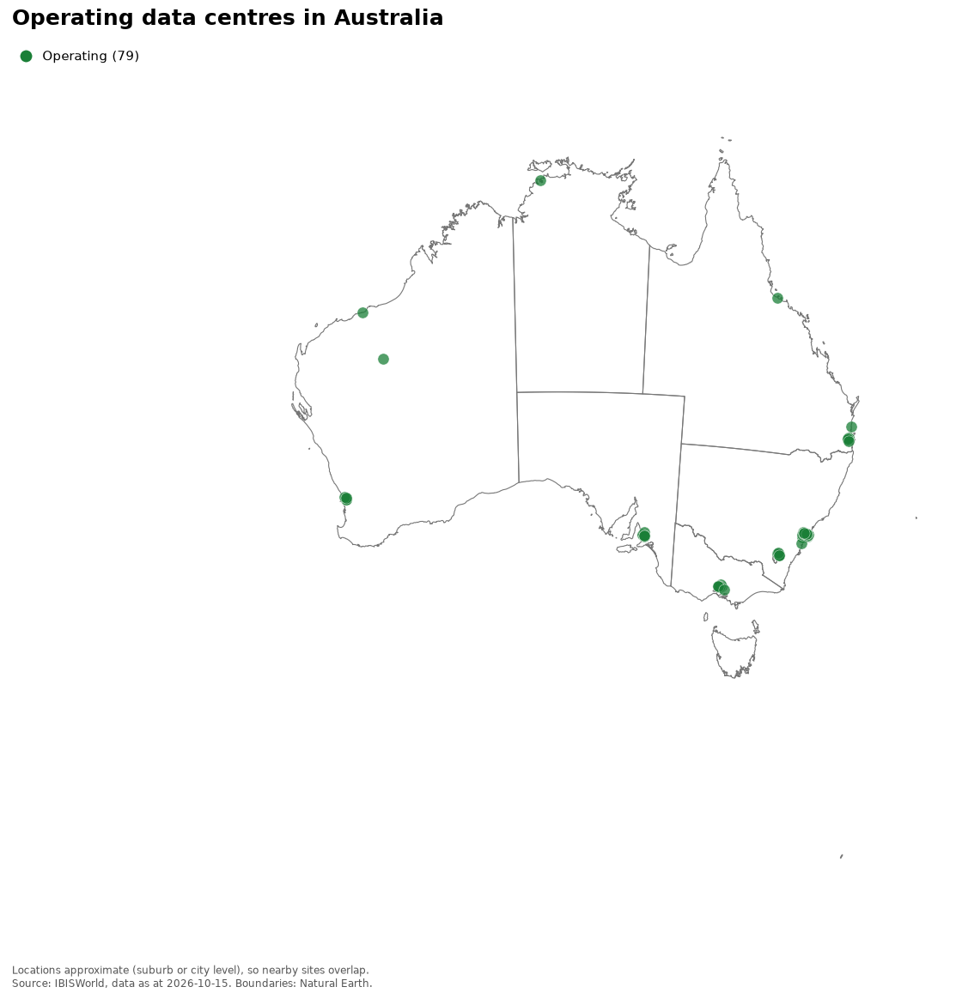
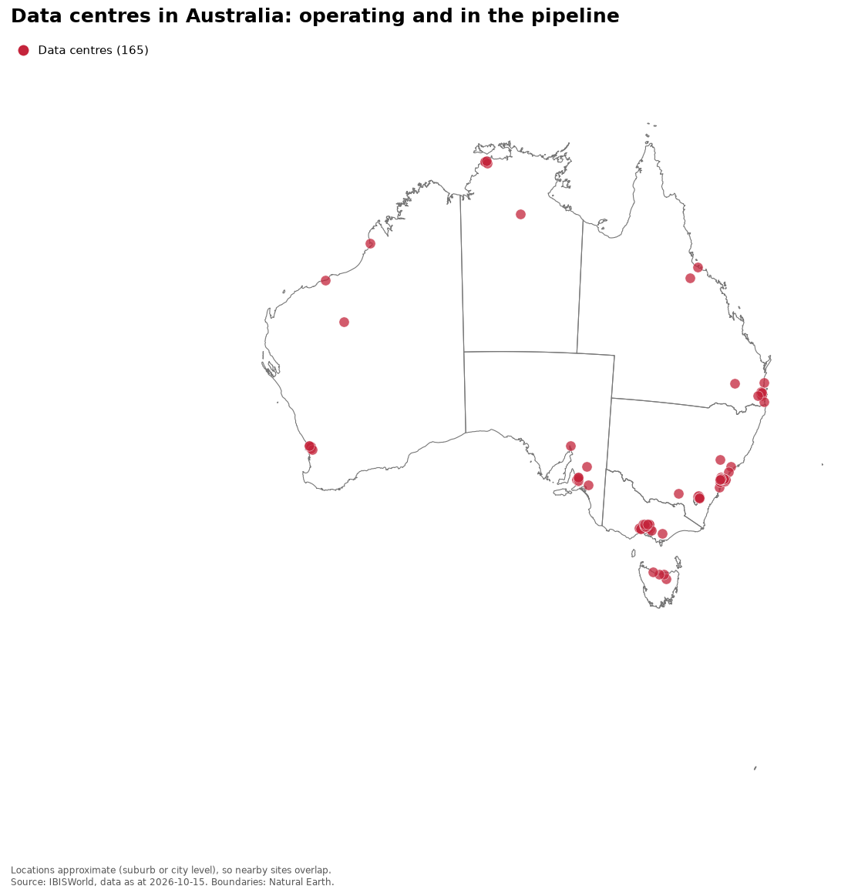
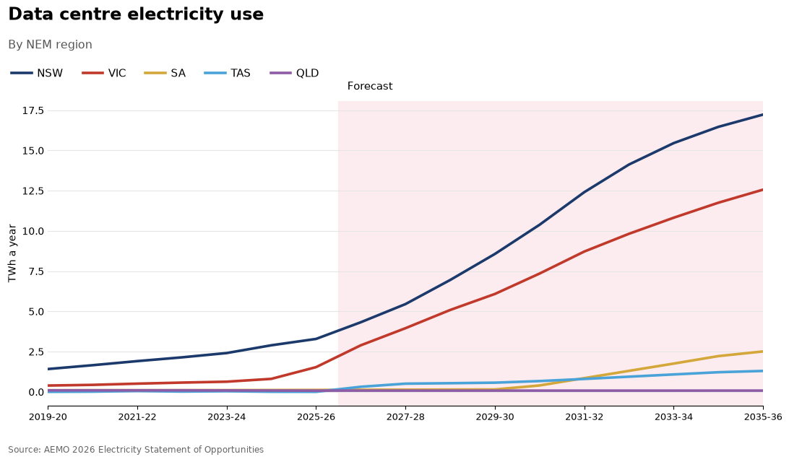
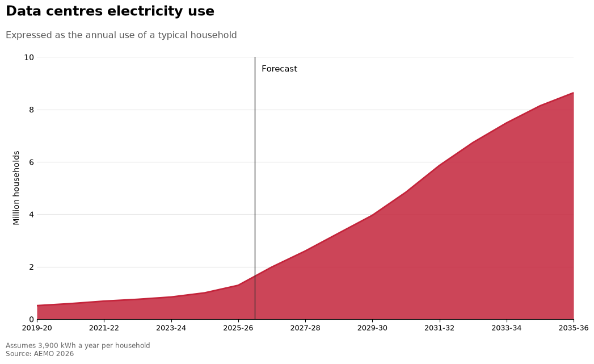
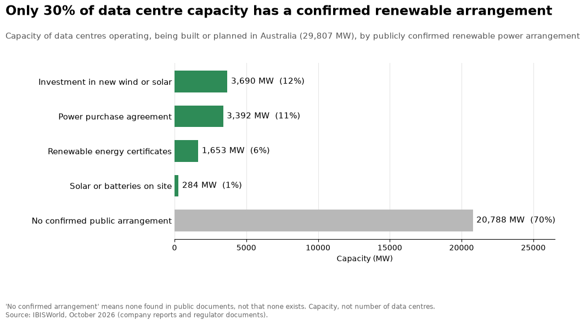

# **Data centres in Australia**

So much of the reporting on data centres in the past has hinged on unknowns and been generally text-heavy/dense. 

There has not been a comprehensive overview of data centres in Australia, despite increasing opposition to their construction.

So, what does the situation look like and how bad are they?

### Analysis will cover:
- How far away people are from data centres?
- Electricity usage
- Water usage
- Noise pollution

### Sources:
Data centres, IBIS World (2026) https://www.ibisworld.com/blog/australia-data-centres-build-out/?utm_medium=email&utm_source=research&utm_campaign=australia-data-centres-build-out

Population data, ABS Digital Atlas Australia (2025) https://digital.atlas.gov.au/maps/digitalatlas::abs-australian-population-grid-2025/about

Electricity usage, AEMO (2026) https://www.aemo.com.au/energy-systems/electricity/national-electricity-market-nem/nem-forecasting-and-planning/forecasting-and-reliability/nem-electricity-statement-of-opportunities-esoo

Forecasted electricity usage (2026), 


### Notes: 
Come back to https://www.oxfordeconomics.com/wp-content/uploads/2026/08/OEA-AEMO-Data-Centre-Report.pdf for idea w/ visualisation


```python
# import packages
#!pip install lerc requests
import json
import pandas as pd
import geopandas as gpd
import matplotlib.pyplot as plt
from matplotlib.lines import Line2D
import numpy as np
from pyproj import Geod
```

# Data centres, contructed and planned


```python
# load data centre location data
path = "/Users/hannah/Desktop/ibisworld_datacentres.json"      
with open(path) as f:
    data = json.load(f)

df = pd.DataFrame(data["fac"])
df["est"] = df["est"].fillna(0).astype(bool)   
df["stage"] = pd.Categorical(
    df["stage"], ["operating", "under construction", "approved", "planned"], ordered=True
)

print("Data as at", data["as_at"], "-", len(df), "sites")
print(df["stage"].value_counts().sort_index())
df.head()
```

    Data as at 2026-10-15 - 165 sites
    stage
    operating             79
    under construction    22
    approved              16
    planned               48
    Name: count, dtype: int64


<div>
<style scoped>
    .dataframe tbody tr th:only-of-type {
        vertical-align: middle;
    }

    .dataframe tbody tr th {
        vertical-align: top;
    }

    .dataframe thead th {
        text-align: right;
    }
</style>
<table border="1" class="dataframe">
  <thead>
    <tr style="text-align: right;">
      <th></th>
      <th>name</th>
      <th>op</th>
      <th>opf</th>
      <th>place</th>
      <th>state</th>
      <th>stage</th>
      <th>mw</th>
      <th>lat</th>
      <th>lon</th>
      <th>prec</th>
      <th>est</th>
      <th>cl</th>
      <th>cln</th>
      <th>post</th>
    </tr>
  </thead>
  <tbody>
    <tr>
      <th>0</th>
      <td>SYD1</td>
      <td>AirTrunk</td>
      <td>AirTrunk</td>
      <td>Huntingwood, New South Wales</td>
      <td>NSW</td>
      <td>operating</td>
      <td>121.0</td>
      <td>-33.80</td>
      <td>150.9</td>
      <td>suburb</td>
      <td>False</td>
      <td>NaN</td>
      <td>NaN</td>
      <td>NaN</td>
    </tr>
    <tr>
      <th>1</th>
      <td>SYD2 (Phase 1)</td>
      <td>AirTrunk</td>
      <td>AirTrunk</td>
      <td>Macquarie Park, New South Wales</td>
      <td>NSW</td>
      <td>operating</td>
      <td>20.0</td>
      <td>-33.78</td>
      <td>151.1</td>
      <td>city</td>
      <td>True</td>
      <td>NaN</td>
      <td>NaN</td>
      <td>NaN</td>
    </tr>
    <tr>
      <th>2</th>
      <td>SYD2 (Phase 2)</td>
      <td>AirTrunk</td>
      <td>AirTrunk</td>
      <td>Macquarie Park, New South Wales</td>
      <td>NSW</td>
      <td>operating</td>
      <td>30.0</td>
      <td>-33.78</td>
      <td>151.1</td>
      <td>city</td>
      <td>True</td>
      <td>NaN</td>
      <td>NaN</td>
      <td>NaN</td>
    </tr>
    <tr>
      <th>3</th>
      <td>SYD2 (Phase 3 / 70MW expansion, final two phases)</td>
      <td>AirTrunk</td>
      <td>AirTrunk</td>
      <td>Macquarie Park, New South Wales</td>
      <td>NSW</td>
      <td>operating</td>
      <td>70.0</td>
      <td>-33.78</td>
      <td>151.1</td>
      <td>city</td>
      <td>False</td>
      <td>NaN</td>
      <td>NaN</td>
      <td>NaN</td>
    </tr>
    <tr>
      <th>4</th>
      <td>Bluett Drive, Smeaton Grange</td>
      <td>Amazon Web Services</td>
      <td>Amazon Web Services</td>
      <td>Smeaton Grange, New South Wales</td>
      <td>NSW</td>
      <td>operating</td>
      <td>NaN</td>
      <td>-34.03</td>
      <td>150.8</td>
      <td>suburb</td>
      <td>False</td>
      <td>Amazon Web Services</td>
      <td>Amazon Web Services (own use)</td>
      <td>NaN</td>
    </tr>
  </tbody>
</table>
</div>


```python
# load Aus shapefile
ALBERS = "EPSG:3577"  
STATES_URL = "https://naciscdn.org/naturalearth/10m/cultural/ne_10m_admin_1_states_provinces.zip"

states = gpd.read_file(STATES_URL)
states = states[states["admin"] == "Australia"].to_crs(ALBERS)

pts = gpd.GeoDataFrame(
    df, geometry=gpd.points_from_xy(df.lon, df.lat), crs="EPSG:4326"
).to_crs(ALBERS)

states[["name"]]   
```


<div>
<style scoped>
    .dataframe tbody tr th:only-of-type {
        vertical-align: middle;
    }

    .dataframe tbody tr th {
        vertical-align: top;
    }

    .dataframe thead th {
        text-align: right;
    }
</style>
<table border="1" class="dataframe">
  <thead>
    <tr style="text-align: right;">
      <th></th>
      <th>name</th>
    </tr>
  </thead>
  <tbody>
    <tr>
      <th>1747</th>
      <td>Western Australia</td>
    </tr>
    <tr>
      <th>1748</th>
      <td>Northern Territory</td>
    </tr>
    <tr>
      <th>1762</th>
      <td>South Australia</td>
    </tr>
    <tr>
      <th>1763</th>
      <td>Queensland</td>
    </tr>
    <tr>
      <th>1764</th>
      <td>New South Wales</td>
    </tr>
    <tr>
      <th>1765</th>
      <td>Jervis Bay Territory</td>
    </tr>
    <tr>
      <th>1766</th>
      <td>Victoria</td>
    </tr>
    <tr>
      <th>2903</th>
      <td>Tasmania</td>
    </tr>
    <tr>
      <th>2925</th>
      <td>Macquarie Island</td>
    </tr>
    <tr>
      <th>2929</th>
      <td>Lord Howe Island</td>
    </tr>
    <tr>
      <th>3847</th>
      <td>Australian Capital Territory</td>
    </tr>
  </tbody>
</table>
</div>


```python
# plot data centre locations
colours = {"operating": "#1a7f37", "under construction": "#e08a00",
           "approved": "#2f6fdb", "planned": "#c4243b"}

def plot_points(stages, title, fname=None, figsize=(14, 12), dot=90, colour=None):
    """Point map of data centres at the given stages, over the state outlines.
    colour: if given, all points use this one colour instead of one per stage."""
    fig, ax = plt.subplots(figsize=figsize)
    fig.subplots_adjust(top=0.88)
    states.plot(ax=ax, facecolor="none", edgecolor="#777", linewidth=0.8)   # outline only
    ax.set_axis_off()

    handles = []
    for stage in stages:
        s = pts[pts.stage == stage]
        c = colour or colours[stage]
        ax.scatter(s.geometry.x, s.geometry.y, s=dot, color=c,
                   alpha=0.75, edgecolor="white", linewidth=0.4)
        if not colour:
            handles.append(Line2D([], [], marker="o", ls="", markersize=11,
                                  markerfacecolor=c, markeredgecolor="white",
                                  label=f"{stage.capitalize()} ({len(s)})"))
    if colour:   # single colour: one legend entry with the total
        total = pts.stage.isin(stages).sum()
        handles.append(Line2D([], [], marker="o", ls="", markersize=11,
                              markerfacecolor=colour, markeredgecolor="white",
                              label=f"Data centres ({total})"))

    fig.text(0.02, 0.97, title, fontsize=18, fontweight="bold", ha="left", va="top")
    fig.legend(handles=handles, loc="upper left", bbox_to_anchor=(0.012, 0.94),
               ncol=len(handles), frameon=False, fontsize=10.5,
               columnspacing=1.6, handletextpad=0.3)
    fig.text(0.02, 0.02, "Locations approximate (suburb or city level), so nearby sites overlap.\n"
             f"Source: IBISWorld, data as at {data['as_at']}. Boundaries: Natural Earth.",
             fontsize=8.5, color="#555")
    if fname:
        fig.savefig(fname, dpi=200, bbox_inches="tight")
    plt.show()

# Map 1: operating only
plot_points(["operating"], "Operating data centres in Australia")

# Map 2: everything, one colour
plot_points(["operating", "under construction", "approved", "planned"],
            "Data centres in Australia: operating and in the pipeline",
            colour="#c4243b")
```


    

    


    

    


# How far away people are from data centres?


```python
# read population data
BASE = "https://tiledimageservices1.arcgis.com/v8Kimc579yljmjSP/arcgis/rest/services/Aus_population_grid_2025/ImageServer"
XMIN, YMAX = -3901000, -1000000          
NCOLS, NROWS, TILE = 7401, 4100, 256     
tile_cols, tile_rows = math.ceil(NCOLS / TILE), math.ceil(NROWS / TILE)

# test one tile first
r = requests.get(f"{BASE}/tile/4/8/10", timeout=60)
res = lerc.decode(r.content)
print(r.status_code, len(r.content), "bytes; decode result code:", res[0])
print([type(x) for x in res])             
print(np.squeeze(res[1]).shape, np.nanmax(res[1]))
```

    200 3688 bytes; decode result code: 0
    [<class 'int'>, <class 'numpy.ndarray'>, <class 'NoneType'>]
    (256, 256) 516.44446


```python
# read fill grid file
grid = np.full((tile_rows * TILE, tile_cols * TILE), np.nan, dtype="float32")
sess = requests.Session()

for row in range(tile_rows):
    for col in range(tile_cols):
        resp = sess.get(f"{BASE}/tile/4/{row}/{col}", timeout=60)
        if resp.status_code != 200 or len(resp.content) < 50:
            continue                                   
        res = lerc.decode(resp.content)
        if res[0] != 0:
            print("decode failed", row, col, res[0]); continue
        arr = np.squeeze(res[1]).astype("float32")
        mask = res[2]
        if mask is not None and np.size(mask):         
            arr = np.where(np.squeeze(mask).astype(bool), arr, np.nan)
        grid[row*TILE:(row+1)*TILE, col*TILE:(col+1)*TILE] = arr
    time.sleep(0.05)                                   

grid = grid[:NROWS, :NCOLS]

rows, cols = np.where(grid > 0)
people = gpd.GeoDataFrame(
    {"pop": grid[rows, cols]},
    geometry=gpd.points_from_xy(XMIN + (cols + 0.5) * 1000, YMAX - (rows + 0.5) * 1000),
    crs="EPSG:3577",
)
print(f"{len(people):,} populated cells")

pd.DataFrame({"x": people.geometry.x, "y": people.geometry.y, "pop": people["pop"]}) \
  .to_csv("pop_grid_2025_cells.csv", index=False)
```

    total population in grid: 27,613,318


```python
# calculate nearest distance
ALBERS = "EPSG:3577"
geod = Geod(ellps="GRS80")

def nearest_distances(people, sites):
    """Great-circle distance (km) from each population point to its nearest site."""
    sites = sites.to_crs(ALBERS).reset_index(drop=True)
    j = gpd.sjoin_nearest(people, sites[["geometry"]], how="left")
    j = j[~j.index.duplicated(keep="first")]                  # ties produce duplicates
    p = people.to_crs(4326).geometry
    s = sites.to_crs(4326).geometry.loc[j["index_right"].astype(int).values]
    _, _, d = geod.inv(p.x.values, p.y.values, s.x.values, s.y.values)
    return d / 1000

def wquantile(x, w, q):
    o = np.argsort(x)
    x, w = np.asarray(x)[o], np.asarray(w)[o]
    c = np.cumsum(w) / w.sum()
    return x[np.searchsorted(c, q)]

def summarise(dist, label):
    w = people["pop"].values
    print(f"\n{label}")
    print(f"  mean distance:   {np.average(dist, weights=w):6.1f} km")
    print(f"  median distance: {wquantile(dist, w, .5):6.1f} km")
    for km in (5, 10, 25, 50, 100):
        print(f"  within {km:>3} km:   {w[dist <= km].sum() / w.sum():6.1%} of people")
```


```python
# print distances
dist_operating = nearest_distances(people, pts[pts.stage == "operating"])
dist_all       = nearest_distances(people, pts)

summarise(dist_operating, "Operating data centres")
summarise(dist_all, "Operating + under construction + approved + planned")
```

    
    Operating data centres
      mean distance:     70.3 km
      median distance:   13.6 km
      within   5 km:    18.3% of people
      within  10 km:    39.6% of people
      within  25 km:    63.6% of people
      within  50 km:    71.6% of people
      within 100 km:    79.1% of people
    
    Operating + under construction + approved + planned
      mean distance:     47.0 km
      median distance:    9.9 km
      within   5 km:    24.0% of people
      within  10 km:    50.3% of people
      within  25 km:    73.4% of people
      within  50 km:    79.8% of people
      within 100 km:    85.2% of people


# Electricity usage
#### Current and forecasted


```python
# data centre electricity use - current + forecasted by region
reg = pd.read_csv("/Users/hannah/Desktop/aemo_2026_esoo_datacentre_consumption_by_region.csv")

wide = reg.pivot(index="financial_year", columns="region", values="data_centre_consumption_twh")
wide = wide[["NEM", "NSW", "VIC", "SA", "TAS", "QLD"]]
    
wide.loc["2019-20":"2035-36"]        
```


<div>
<style scoped>
    .dataframe tbody tr th:only-of-type {
        vertical-align: middle;
    }

    .dataframe tbody tr th {
        vertical-align: top;
    }

    .dataframe thead th {
        text-align: right;
    }
</style>
<table border="1" class="dataframe">
  <thead>
    <tr style="text-align: right;">
      <th>region</th>
      <th>NEM</th>
      <th>NSW</th>
      <th>VIC</th>
      <th>SA</th>
      <th>TAS</th>
      <th>QLD</th>
    </tr>
    <tr>
      <th>financial_year</th>
      <th></th>
      <th></th>
      <th></th>
      <th></th>
      <th></th>
      <th></th>
    </tr>
  </thead>
  <tbody>
    <tr>
      <th>2019-20</th>
      <td>2.011</td>
      <td>1.419</td>
      <td>0.394</td>
      <td>0.099</td>
      <td>0.003</td>
      <td>0.096</td>
    </tr>
    <tr>
      <th>2020-21</th>
      <td>2.308</td>
      <td>1.657</td>
      <td>0.436</td>
      <td>0.103</td>
      <td>0.015</td>
      <td>0.097</td>
    </tr>
    <tr>
      <th>2021-22</th>
      <td>2.678</td>
      <td>1.911</td>
      <td>0.511</td>
      <td>0.103</td>
      <td>0.056</td>
      <td>0.097</td>
    </tr>
    <tr>
      <th>2022-23</th>
      <td>2.947</td>
      <td>2.146</td>
      <td>0.577</td>
      <td>0.106</td>
      <td>0.020</td>
      <td>0.097</td>
    </tr>
    <tr>
      <th>2023-24</th>
      <td>3.289</td>
      <td>2.412</td>
      <td>0.633</td>
      <td>0.109</td>
      <td>0.042</td>
      <td>0.092</td>
    </tr>
    <tr>
      <th>2024-25</th>
      <td>3.910</td>
      <td>2.895</td>
      <td>0.809</td>
      <td>0.114</td>
      <td>0.008</td>
      <td>0.084</td>
    </tr>
    <tr>
      <th>2025-26</th>
      <td>5.029</td>
      <td>3.290</td>
      <td>1.537</td>
      <td>0.120</td>
      <td>0.004</td>
      <td>0.078</td>
    </tr>
    <tr>
      <th>2026-27</th>
      <td>7.741</td>
      <td>4.325</td>
      <td>2.893</td>
      <td>0.129</td>
      <td>0.317</td>
      <td>0.078</td>
    </tr>
    <tr>
      <th>2027-28</th>
      <td>10.135</td>
      <td>5.454</td>
      <td>3.956</td>
      <td>0.135</td>
      <td>0.511</td>
      <td>0.078</td>
    </tr>
    <tr>
      <th>2028-29</th>
      <td>12.799</td>
      <td>6.951</td>
      <td>5.088</td>
      <td>0.143</td>
      <td>0.539</td>
      <td>0.078</td>
    </tr>
    <tr>
      <th>2029-30</th>
      <td>15.450</td>
      <td>8.568</td>
      <td>6.083</td>
      <td>0.150</td>
      <td>0.572</td>
      <td>0.078</td>
    </tr>
    <tr>
      <th>2030-31</th>
      <td>18.882</td>
      <td>10.383</td>
      <td>7.351</td>
      <td>0.399</td>
      <td>0.672</td>
      <td>0.078</td>
    </tr>
    <tr>
      <th>2031-32</th>
      <td>22.863</td>
      <td>12.408</td>
      <td>8.719</td>
      <td>0.854</td>
      <td>0.803</td>
      <td>0.078</td>
    </tr>
    <tr>
      <th>2032-33</th>
      <td>26.276</td>
      <td>14.125</td>
      <td>9.822</td>
      <td>1.306</td>
      <td>0.944</td>
      <td>0.078</td>
    </tr>
    <tr>
      <th>2033-34</th>
      <td>29.196</td>
      <td>15.456</td>
      <td>10.820</td>
      <td>1.758</td>
      <td>1.084</td>
      <td>0.078</td>
    </tr>
    <tr>
      <th>2034-35</th>
      <td>31.743</td>
      <td>16.466</td>
      <td>11.753</td>
      <td>2.223</td>
      <td>1.221</td>
      <td>0.079</td>
    </tr>
    <tr>
      <th>2035-36</th>
      <td>33.687</td>
      <td>17.229</td>
      <td>12.565</td>
      <td>2.513</td>
      <td>1.301</td>
      <td>0.079</td>
    </tr>
  </tbody>
</table>
</div>


```python
# plot by region
regions = ["NSW", "VIC", "SA", "TAS", "QLD"]
colours = {"NSW": "#1b3a6b", "VIC": "#c0392b", "SA": "#d4a73a", "TAS": "#4aa3d8", "QLD": "#8e5ba6"}

d = wide.loc["2019-20":"2035-36", regions]
x = list(range(len(d)))
fc = list(d.index).index("2026-27")

fig, ax = plt.subplots(figsize=(11, 6.5))
fig.subplots_adjust(top=0.76, left=0.07, right=0.97)

lines = []
for r in regions:
    (ln,) = ax.plot(x, d[r], color=colours[r], linewidth=2.6, label=r)
    lines.append(ln)

ax.axvspan(fc - 0.5, x[-1], color="#fdecef", zorder=0)   
ax.text(fc - 0.3, 19.3, "Forecast", fontsize=11, va="top")

ticks = [i for i in x if i % 2 == 0]
ax.set_xticks(ticks)
ax.set_xticklabels([d.index[i] for i in ticks], rotation=0, fontsize=9.5)
ax.set_xlim(0, x[-1]) 
ax.set_ylabel("TWh a year")
ax.grid(axis="y", color="#e5e5e5")
ax.set_axisbelow(True)
for side in ("top", "right", "left"):
    ax.spines[side].set_visible(False)
ax.tick_params(axis="y", length=0)

fig.text(0.02, 0.96, "Data centre electricity use",
         fontsize=17, fontweight="bold", ha="left", va="top")
fig.text(0.02, 0.89, "By NEM region",
         fontsize=11.5, color="#555", ha="left", va="top")

fig.legend(handles=lines, loc="upper left", bbox_to_anchor=(0.012, 0.85),
           ncol=len(regions), frameon=False, fontsize=11,
           columnspacing=1.8, handlelength=1.8, handletextpad=0.5)

fig.text(0.02, 0.01, "Source: AEMO 2026 Electricity Statement of Opportunities",
         fontsize=8.5, color="#666")

plt.show()
```


    

    


```python
# benchmarking this to household electricity use  
# TWh to kWh - divided by kWh per home, in mil
KWH_PER_HOME = 4000                      
LOW, HIGH = 3900, 4600                   

nem = reg[reg.region == "NEM"].set_index("financial_year")["data_centre_consumption_twh"]

def homes_millions(twh, kwh=KWH_PER_HOME):
    return twh * 1e9 / kwh / 1e6        

years = ["2019-20", "2025-26", "2029-30", "2033-34", "2035-36", "2049-50"]
out = pd.DataFrame({
    "TWh": nem.loc[years],
    "homes_m (central)": homes_millions(nem.loc[years]),
    f"homes_m ({HIGH:,} kWh)": homes_millions(nem.loc[years], HIGH),
    f"homes_m ({LOW:,} kWh)": homes_millions(nem.loc[years], LOW),
}).round(2)
out
```


<div>
<style scoped>
    .dataframe tbody tr th:only-of-type {
        vertical-align: middle;
    }

    .dataframe tbody tr th {
        vertical-align: top;
    }

    .dataframe thead th {
        text-align: right;
    }
</style>
<table border="1" class="dataframe">
  <thead>
    <tr style="text-align: right;">
      <th></th>
      <th>TWh</th>
      <th>homes_m (central)</th>
      <th>homes_m (4,600 kWh)</th>
      <th>homes_m (3,900 kWh)</th>
    </tr>
    <tr>
      <th>financial_year</th>
      <th></th>
      <th></th>
      <th></th>
      <th></th>
    </tr>
  </thead>
  <tbody>
    <tr>
      <th>2019-20</th>
      <td>2.01</td>
      <td>0.50</td>
      <td>0.44</td>
      <td>0.52</td>
    </tr>
    <tr>
      <th>2025-26</th>
      <td>5.03</td>
      <td>1.26</td>
      <td>1.09</td>
      <td>1.29</td>
    </tr>
    <tr>
      <th>2029-30</th>
      <td>15.45</td>
      <td>3.86</td>
      <td>3.36</td>
      <td>3.96</td>
    </tr>
    <tr>
      <th>2033-34</th>
      <td>29.20</td>
      <td>7.30</td>
      <td>6.35</td>
      <td>7.49</td>
    </tr>
    <tr>
      <th>2035-36</th>
      <td>33.69</td>
      <td>8.42</td>
      <td>7.32</td>
      <td>8.64</td>
    </tr>
    <tr>
      <th>2049-50</th>
      <td>43.52</td>
      <td>10.88</td>
      <td>9.46</td>
      <td>11.16</td>
    </tr>
  </tbody>
</table>
</div>


```python
reg = pd.read_csv("/Users/hannah/Desktop/aemo_2026_esoo_datacentre_consumption_by_region.csv")
nem = reg[reg.region == "NEM"].set_index("financial_year").loc["2019-20":"2035-36"]

KWH_PER_HOME = 3900
def homes_m(twh, kwh):
    return twh * 1e9 / kwh / 1e6

homes = homes_m(nem.data_centre_consumption_twh, KWH_PER_HOME)

x = list(range(len(nem)))
fc = list(nem.index).index("2026-27")

fig, ax = plt.subplots(figsize=(11, 6.5))
fig.subplots_adjust(top=0.82, left=0.07, right=0.93)

ax.fill_between(x, homes, color="#c4243b", alpha=0.85, linewidth=0)
ax.plot(x, homes, color="#c4243b", linewidth=2)

ax.axvline(fc - 0.5, color="#333", linewidth=1)
ax.text(fc - 0.3, 9.7, "Forecast", fontsize=11, va="top")

ticks = [i for i in x if i % 2 == 0]
ax.set_xticks(ticks)
ax.set_xticklabels([nem.index[i] for i in ticks], fontsize=9.5)
ax.set_xlim(0, x[-1]); ax.set_ylim(0, 10)
ax.set_ylabel("Million households")
ax.grid(axis="y", color="#e5e5e5"); ax.set_axisbelow(True)
for s in ("top", "right", "left"):
    ax.spines[s].set_visible(False)
ax.tick_params(axis="y", length=0)

end = homes.iloc[-1]
fig.text(0.02, 0.96, f"Data centres electricity use",
         fontsize=17, fontweight="bold", ha="left", va="top")
fig.text(0.02, 0.89, "Expressed as the annual use of a typical household",
         fontsize=11.5, color="#555", ha="left", va="top")
fig.text(0.02, 0.01, "Assumes 3,900 kWh a year per household"
         "\nSource: AEMO 2026",
         fontsize=8.5, color="#666")

# fig.savefig("datacentres_in_households.png", dpi=200, bbox_inches="tight")
plt.show()
```


    

    


```python
# stats for copy
KWH = 3900                                  
SIX_CAPITALS_TWH = 23.3                      
SHARE_2033_34 = 12.4                         

reg = pd.read_csv("/Users/hannah/Desktop/aemo_2026_esoo_datacentre_consumption_by_region.csv")
nem = reg[reg.region == "NEM"].set_index("financial_year")["data_centre_consumption_twh"]

base = nem["2025-26"]
print(f"2025-26: {base:.2f} TWh = {base*1e9/KWH/1e6:.2f} million households at {KWH:,} kWh")

print("\nGrowth vs 2025-26, and vs all homes in six capitals")
rows = []
for fy in ["2031-32", "2032-33", "2033-34"]:
    v = nem[fy]
    rows.append({"year": fy, "TWh": round(v, 1),
                 "increase_%": round(100 * (v / base - 1)),
                 "times_2025-26": round(v / base, 1),
                 "households_m": round(v * 1e9 / KWH / 1e6, 1),
                 "vs_six_capitals_%": round(100 * (v / SIX_CAPITALS_TWH - 1))})
print(pd.DataFrame(rows).to_string(index=False))

first = next(fy for fy, v in nem.items() if v > SIX_CAPITALS_TWH)
print(f"\nFirst year above the six capitals' {SIX_CAPITALS_TWH} TWh: {first} ({nem[first]:.1f} TWh)")

print(f"\nShare of NEM electricity in 2033-34 (IBISWorld): {SHARE_2033_34}% = about 1 in {100/SHARE_2033_34:.0f}")
```

    2025-26: 5.03 TWh = 1.29 million households at 3,900 kWh
    
    Growth vs 2025-26, and vs all homes in six capitals
       year  TWh  increase_%  times_2025-26  households_m  vs_six_capitals_%
    2031-32 22.9         355            4.5           5.9                 -2
    2032-33 26.3         422            5.2           6.7                 13
    2033-34 29.2         481            5.8           7.5                 25
    
    First year above the six capitals' 23.3 TWh: 2032-33 (26.3 TWh)
    
    Share of NEM electricity in 2033-34 (IBISWorld): 12.4% = about 1 in 8


```python
import pandas as pd
import matplotlib.pyplot as plt

power = pd.DataFrame({
    "arrangement": ["Investment in new wind or solar", "Power purchase agreement",
                    "Renewable energy certificates", "Solar or batteries on site",
                    "No confirmed public arrangement"],
    "mw": [3690, 3392, 1653, 284, 20788],
})
total = power.mw.sum()
renewable = power.mw[:4].sum()
power["pct"] = 100 * power.mw / total

colours = ["#2e8b57"] * 4 + ["#b8b8b8"]
fig, ax = plt.subplots(figsize=(11, 6.2))
fig.subplots_adjust(top=0.78, bottom=0.26, left=0.30, right=0.93)

y = range(len(power))[::-1]
ax.barh(list(y), power.mw, color=colours, height=0.62)
for yi, mw, pct in zip(y, power.mw, power.pct):
    ax.text(mw + 250, yi, f"{mw:,} MW  ({pct:.0f}%)", va="center", fontsize=10.5)

ax.set_yticks(list(y)); ax.set_yticklabels(power.arrangement, fontsize=11)
ax.set_xlim(0, 26500)
ax.set_xlabel("Capacity (MW)")
ax.grid(axis="x", color="#e5e5e5"); ax.set_axisbelow(True)
for s in ("top", "right", "left"):
    ax.spines[s].set_visible(False)
ax.tick_params(axis="y", length=0)

fig.text(0.02, 0.95, f"Only {100*renewable/total:.0f}% of data centre capacity has a confirmed renewable arrangement",
         fontsize=17, fontweight="bold", ha="left", va="top")
fig.text(0.02, 0.87, f"Capacity of data centres operating, being built or planned in Australia ({total:,} MW), "
         "by publicly confirmed renewable power arrangement", fontsize=11, color="#555", ha="left", va="top")
fig.text(0.02, 0.03, "'No confirmed arrangement' means none found in public documents, not that none exists. "
         "Capacity, not number of data centres.\nSource: IBISWorld, October 2026 (company reports and regulator documents).",
         fontsize=8.5, color="#666")
plt.show()
```


    

    


```python
HOURS_PER_YEAR = 8760
KWH_PER_HOUSEHOLD = (3900 + 4900 + 4600 + 4600 + 4000) / 5   # AER DMO 2026-27 regional usage levels = 4,400

has_mw = df.dropna(subset=["mw"])
operating_gw = has_mw.loc[has_mw["stage"] == "operating", "mw"].sum() / 1000
all_gw = has_mw["mw"].sum() / 1000

def households(gw):
    return gw * 1e6 * HOURS_PER_YEAR / KWH_PER_HOUSEHOLD

print(f"Sites with no MW figure (excluded): {len(df) - len(has_mw)}")
print(f"1. Operational: {operating_gw:.2f} GW at 100% capacity = {households(operating_gw)/1e6:.1f} million households")
print(f"2. All sites:   {all_gw:.2f} GW at 100% capacity = {households(all_gw)/1e6:.1f} million households")
```

    Sites with no MW figure (excluded): 25
    1. Operational: 2.34 GW at 100% capacity = 4.7 million households
    2. All sites:   29.81 GW at 100% capacity = 59.3 million households


## Top line

Running at full capacity, Australia's operating data centres currently use 2.34GW of electricity, equivalent to 4.7 million households. If all the data centres that are currently in the IBISWorld dataset pipeline are constructed + operational, this would increase the total to 29.81GW. This is equivalent to 59.3 million households.

My analysis compared to others is much higher, mainly because it assumes that every site draws full capacity each year - in reality this won't be the case

## Analysis

Uses IBISWorld's October 2026 list of Australian data centres, which gives each site's capacity in megawatts (MW) - this is the most a site is designed to draw once fully built, not what it actually uses day to day

These figures sum capacity for 
a) sites already operating 
b) all sites, including those under construction, approved or planned. 

Sites with no confirmed capacity were left out, so the totals are likely an undercount.

The figures assume that every site runs at full capacity all year (8,760 hours), so is an upper estimate, representing the maximum possible annual electricity use

It is converted to /households by dividing that energy by the electricity a typical household uses in a year (4,400 kWh) - this is the average of the five regional "typical household" usage levels the Australian Energy Regulator 'Default market offer prices 2026-7' table 2.1, used to set 2026–27 default electricity prices 

# Water usage
#### Current and forecasted


```python
HOURS_PER_YEAR = 8760
PUE = 1.44                      # NextDC FY25 ESG report
KL_PER_HOUSEHOLD = 176          # ABS, average household water use 2024-25
WUE = {"low": 0.10, "central": 1.6, "high": 2.4}   # litres per kWh of IT energy (Australian sources)

has_mw = df.dropna(subset=["mw"])
operating_gw = has_mw.loc[has_mw["stage"] == "operating", "mw"].sum() / 1000
all_gw = has_mw["mw"].sum() / 1000

def water_litres(gw, wue):
    it_kwh = gw * 1e6 * HOURS_PER_YEAR / PUE
    return it_kwh * wue

def households(litres):
    return litres / (KL_PER_HOUSEHOLD * 1000)

print(f"Sites with no MW figure (excluded): {len(df) - len(has_mw)}\n")
for label, gw in [("1. Operational", operating_gw), ("2. All sites", all_gw)]:
    print(f"{label} ({gw:.2f} GW at 100% capacity)")
    for name, wue in WUE.items():
        L = water_litres(gw, wue)
        print(f"  {name:8s} (WUE {wue}): {L/1e9:,.1f} GL/yr = {households(L):,.0f} households' water")
```

    Sites with no MW figure (excluded): 25
    
    1. Operational (2.34 GW at 100% capacity)
      low      (WUE 0.1): 1.4 GL/yr = 8,105 households' water
      central  (WUE 1.6): 22.8 GL/yr = 129,680 households' water
      high     (WUE 2.4): 34.2 GL/yr = 194,520 households' water
    2. All sites (29.81 GW at 100% capacity)
      low      (WUE 0.1): 18.1 GL/yr = 103,026 households' water
      central  (WUE 1.6): 290.1 GL/yr = 1,648,412 households' water
      high     (WUE 2.4): 435.2 GL/yr = 2,472,618 households' water


## Top line

At full capacity, Australia's operating data centres could use around 23 billion litres of water a year, with estimates ranging from 1 to 34 billion depending on cooling technology. If every planned project were built, that could rise to about 290 billion litres, with a range of 18 to 435 billion.

My analysis compared to others (5.5GL a year, industry commissioned analysis) is much higher, mainly because it assumes that every site draws full capacity each year - in reality this won't be the case

## Analysis

The amount of water used varies widely with design. These estimates used three values for banded estimates (all dervied from Australian data centre surces)

Low = 0.10 litres per kWh (Amazon, Sydney)

Medium = 1.6 litres per kWh (Australian modelling assumption) 

High = 2.4 litres per kWh (NextDC).

To get a per household figure, total water is divded by what an average Australian household uses in a year: 176,000 litres (according to ABS)

Sources are Amazon Australia, UNSW/APVI paper, NextDC FY25 ESG report and Reuters, ABS Water Account.

Notes: 
This is modelled, not measured, and it is a maximum, since sites won't all run flat out.

The water values differ by 24 times (0.10 vs 2.4), so the range is most important

Only on-site water is counted, mostly cooling. Water used to generate the electricity is excluded and in reality, this will count for a lot

Industry-commissioned analysis puts current direct water use across Australian data centres at about 5.5 GL a year, per the University of Melbourne. Our operational figures are higher because they assume maximum draw.

Sites with no MW figure are excluded.

# Noise pollution
#### Current and forecasted


```python
import numpy as np

# ---- 1. Legal night-time limit (dB(A)) by state/territory -------------------
NIGHT_LIMIT_DBA = {
    "NSW": 40,    # NSW EPA Noise Policy for Industry 2017, Table 2.2: suburban night amenity level (LAeq; urban = 45)
    "WA":  35,    # Env Protection (Noise) Regs 1997, Table 1: night LA10 baseline, noise-sensitive premises (before 'influencing factor')
    "TAS": 40,    # Env Mgmt & Pollution Control (Noise) Regs 2026, reg 7: fixed equipment, 10pm-7am
    "ACT": 35,    # Env Protection Regulation 2005, Sch 2 Table 2.2: zone G (residential) night
    "VIC": None,  # NOT SINGLE-VALUED: zone-based limits (roughly 32-48 dB(A) at night), 55 dB(A) night cap
    "QLD": None,  # Policy gives only an indoor sleep objective (30 dB LAeq,1hr), no outdoor night limit
    "SA":  None,  # not verified (source blocked)
    "NT":  None,  # not verified (source blocked); NT sets limits case by case
}
FALLBACK_DBA = 40   # optional: a value to use for the None states above, e.g. 40

df["Legal limit"] = df["state"].map(NIGHT_LIMIT_DBA).astype(float)
if FALLBACK_DBA is not None:
    df["Legal limit"] = df["Legal limit"].fillna(FALLBACK_DBA)
print(df.groupby("state")["Legal limit"].first())
print(df["Legal limit"].isna().sum(), "sites have no limit and are excluded from the noise analysis")

# ---- 2. Cumulative noise from nearby data centres ---------------------------
REF_M = 300        # assume each site just meets its limit at a receptor this far away
RADIUS_KM = 5      # only count data centres within this distance

def cumulative_noise(sub):
    lat, lon = np.radians(sub["lat"].values), np.radians(sub["lon"].values)
    a = (np.sin((lat[:, None] - lat[None, :]) / 2) ** 2
         + np.cos(lat)[:, None] * np.cos(lat)[None, :] * np.sin((lon[:, None] - lon[None, :]) / 2) ** 2)
    d_km = 2 * 6371 * np.arcsin(np.sqrt(a))                  # distance between every pair of sites
    L = sub["Legal limit"].values
    atten = 20 * np.log10(np.maximum(d_km * 1000, REF_M) / REF_M)   # spherical spreading
    contrib = 10 ** ((L[None, :] - atten) / 10)               # energy from source j at receptor i
    contrib[d_km > RADIUS_KM] = 0
    cum = 10 * np.log10(contrib.sum(axis=1))                  # add sound energy, not dB
    n_near = (d_km <= RADIUS_KM).sum(axis=1) - 1
    return cum, n_near

sites = df.dropna(subset=["Legal limit", "lat", "lon"]).copy()
for suffix, mask in [("operating", sites["stage"] == "operating"),
                     ("all", sites["stage"].notna())]:
    sub = sites[mask]
    cum, n = cumulative_noise(sub)
    sites.loc[sub.index, f"neighbours_{suffix}"] = n
    sites.loc[sub.index, f"cum_dB_{suffix}"] = cum
    sites.loc[sub.index, f"uplift_dB_{suffix}"] = cum - sub["Legal limit"].values

# ---- 3. Results ---------------------------------------------------------------
op = sites[sites["stage"] == "operating"]
print("\nOperating sites: average noise uplift above a single site's legal limit (dB)")
print(op.groupby("state")[["neighbours_operating", "uplift_dB_operating", "uplift_dB_all"]]
        .agg(["mean", "max"]).round(1))

print("\nTen noisiest locations if the whole pipeline is built (one row per map location):")
sites["sites_at_location"] = sites.groupby(["lat", "lon"])["name"].transform("count")
hot = (sites.sort_values("uplift_dB_all", ascending=False)
            .drop_duplicates(["lat", "lon"])
            .head(10)[["place", "state", "sites_at_location", "Legal limit",
                       "neighbours_all", "cum_dB_all", "uplift_dB_all"]])
print(hot.round(1).to_string(index=False))
```

    state
    ACT    35.0
    NSW    40.0
    NT     40.0
    QLD    40.0
    SA     40.0
    TAS    40.0
    VIC    40.0
    WA     35.0
    Name: Legal limit, dtype: float64
    0 sites have no limit and are excluded from the noise analysis
    
    Operating sites: average noise uplift above a single site's legal limit (dB)
          neighbours_operating      uplift_dB_operating      uplift_dB_all      
                          mean  max                mean  max          mean   max
    state                                                                       
    ACT                    1.1  2.0                 2.1  4.8           2.5   4.9
    NSW                    3.8  8.0                 3.8  8.5           5.9  10.8
    NT                     0.0  0.0                 0.0  0.0           3.0   3.0
    QLD                    1.6  3.0                 1.5  3.2           1.9   4.8
    SA                     1.3  2.0                 2.0  3.0           2.5   3.0
    VIC                    2.0  3.0                 2.8  4.8           5.2   8.5
    WA                     1.6  3.0                 3.3  6.0           3.7   6.0
    
    Ten noisiest locations if the whole pipeline is built (one row per map location):
                              place state  sites_at_location  Legal limit  neighbours_all  cum_dB_all  uplift_dB_all
    Macquarie Park, New South Wales   NSW                 12         40.0            12.0        50.8           10.8
     Eastern Creek, New South Wales   NSW                  9         40.0             9.0        49.5            9.5
                Truganina, Victoria   VIC                  7         40.0             6.0        48.5            8.5
                Spotswood, Victoria   VIC                  5         40.0             5.0        47.0            7.0
       Kemps Creek, New South Wales   NSW                  5         40.0             5.0        47.0            7.0
                 Brooklyn, Victoria   VIC                  4         40.0             8.0        46.2            6.2
        Alexandria, New South Wales   NSW                  4         40.0            11.0        46.1            6.1
          Artarmon, New South Wales   NSW                  4         40.0             4.0        46.1            6.1
              Tullamarine, Victoria   VIC                  4         40.0             3.0        46.0            6.0
           Perth, Western Australia    WA                  4         35.0             3.0        41.0            6.0


## Top line

Modelling suggests the biggest noise risk from Australia's data centre boom is clustering. Assuming every approved site just meets its state's night-time limit, a cluster of 12 data centres in Macquarie Park, Sydney, would produce about 11 decibels more noise than one site alone is allowed to make, and nine at Eastern Creek about 9.5. Across NSW, today's operating sites sit about 4 decibels above a single-site limit on average. If the full pipeline were built, that would rise to nearly 6. 

These are modelled worst-case estimates, not measurements, and noise limits for Victoria, Queensland, South Australia and the Northern Territory are placeholders.

## Analysis

The legal night-time noise limit was used for each state:
NSW: 40 dB(A)
Tasmania: 40 dB(A)
WA: 35 dB(A)
ACT: 35 dB(A)

Victoria's limit varies by zone, Queensland has no outdoor night limit, and SA and the NT are unclear. For those four, a 40 dB(A) placeholder was used.

We assumed every approved or operating site produces noise right up to its limit, measured about 300 metres away.

Noise fades with distance, so for each site, we added the noise from every other data centre within 5 km, scaled for distance. We did this twice, once for operating sites only and once with the pipeline included.

We compared the combined noise to what one site alone is allowed.

Sources

Data centre locations: IBISWorld facility list, October 2026.
NSW: EPA, Noise Policy for Industry (2017), Table 2.2.
WA: Environmental Protection (Noise) Regulations 1997, Table 1.
Tasmania: Environmental Management and Pollution Control (Noise) Regulations 2026, regulation 7.
ACT: Environment Protection Regulation 2005, Schedule 2.

Caveats to include

Modelled, not measured. No noise readings were used. These are worst-case estimates based on each site just meeting its limit.
Placeholder limits. Results for Victoria, Queensland, SA and the NT use 40 dB(A), not the real legal limits. Victoria's actual limits vary by area (roughly 32 to 48 dB(A) at night).
Limits aren't identical. States measure noise slightly differently, and NSW's figure is a guideline level, not a strict legal cap.
Locations are approximate. The dataset rounds locations to about a kilometre and many sites share the same point, so clusters are treated as sitting on top of each other. Use the figures to compare areas, not as exact decibel readings.
Not a measure of actual annoyance. Real noise at a home depends on distance, buildings, terrain and cooling equipment design.


```python

```
